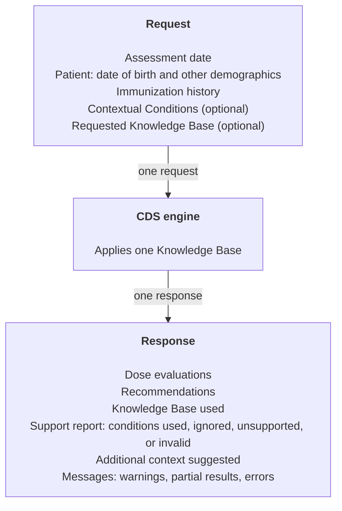
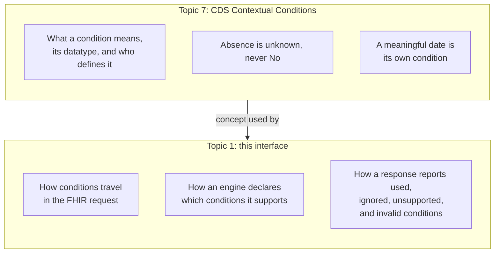
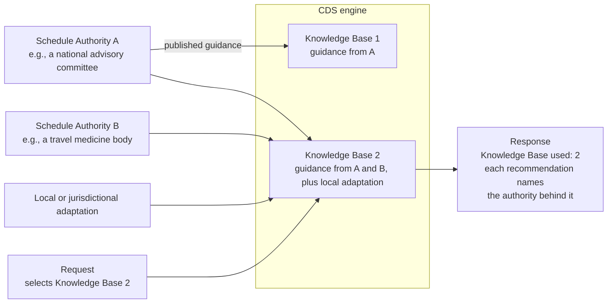
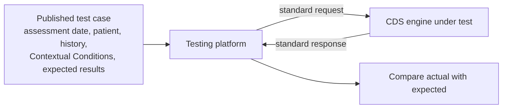

<!--
GENERATED FILE. DO NOT EDIT DIRECTLY.

The authoritative source is in content/. Regenerate this reading copy with:
    python process/tools/build_core_markdown.py --assembly ImmunizationCDS.qmd
-->

# Immunization CDS (ImmDS + HALO)

*Working Proposal for Community Discussion — Not a Standard or Final Decision*

> This is a generated reading copy for GitHub. For review and editing, use the
> [canonical section files](content/README.md).

---

# Scope and Use Cases

## Status

**Version 0.2.0: working preview for community reaction.**

This is a working draft, not a standard, approved specification, ballot
artifact, or clinical guidance. It gathers in one place what the Immunization
CDS (ImmDS + HALO) work has proposed and discussed so far, so the community can
correct it. It is unfinished. Disagreements and open questions are left visible
on purpose, in [Working Decisions](content/90-working-decisions.md#working-decisions).

Corrections are welcome as comments on the published page, as GitHub issues,
or in the
[topic 1 meetings](https://informatics.immregistries.org/hub/es/topic/1).

## In brief

Immunization clinical decision support (CDS) engines evaluate a patient's
immunization history and recommend the vaccinations due now or later. Many
engines run as independent services that receive patient information and
return evaluations and recommendations. They perform similar functions but use
different proprietary interfaces. That raises integration costs, makes it hard
to switch engines, and makes testing and validation harder.

Immunization CDS (ImmDS + HALO) defines **one common service interface for
immunization CDS engines**. It standardizes the exchange between a system that
requests immunization decision support and the engine that provides it. It does
**not** standardize clinical decision logic, vaccination schedules, or
forecasting methods.

The name joins the original Immunization Decision Support Forecast (ImmDS)
interface with HALO, short for **H**ealth, **A**ge, **L**ifestyle,
**O**ccupation, and other factors. HALO is implemented as
[Contextual Conditions](https://immregistries.github.io/contextual-conditions/latest/),
the subject of [topic 7](https://informatics.immregistries.org/hub/es/topic/7):
neutral, coded facts about a patient's circumstances that the requesting system
supplies and the engine may use.

## Use cases {#use-cases}

The interface serves two primary use cases.

1. **Access to CDS from any provider.** An immunization information system
   (IIS), electronic health record (EHR), pharmacy system, public health
   application, or any other health information system calls immunization CDS
   services from different vendors and organizations through one common
   integration. It can change or add engines without building a new interface.

2. **Testing and validation.** A testing platform sends published test cases
   to a CDS engine through the same interface and compares the results with the
   expected outcomes. See [Testing and validation](content/04-fhir-and-testing.md#testing).

## What is in scope {#in-scope}

- The stateless request and response between a requesting system and a CDS
  engine: assessment date, patient, immunization history, and Contextual
  Conditions in; dose evaluations and recommendations out.
- **Communicating Contextual Conditions** in the request, and how an engine
  **indicates support** for them, both in advance and in each response.
- Identifying the [Knowledge Base](content/02-knowledge-bases-and-capabilities.md#knowledge-bases)
  an engine applied, and the guidance behind each recommendation.
- How evaluations and recommendations are expressed: target disease, forecast
  status and reason, recommendation category, series, season, and similar
  elements.
- Identifying the CDS engine itself, separately from its Knowledge Base, and
  capability discovery: asking an engine what it supports before any patient
  data is sent.
- A FHIR R6 representation, with the changes to FHIR resources it needs, plus
  examples, terminology guidance, and support for testing.

## What is out of scope {#out-of-scope}

- Clinical decision logic, vaccination schedules, forecasting methods, and how
  an engine computes its results.
- How Contextual Conditions are collected, inferred, maintained, or governed,
  and how an engine uses them. What a Contextual Condition *is* belongs to
  [topic 7](https://informatics.immregistries.org/hub/es/topic/7).
- Engines retrieving data from other systems, interpreting medical records, or
  inferring missing information.
- Clinician workflow, user interface, and presentation of results. This
  includes calling CDS at points in an EHR workflow, which is the role of CDS
  Hooks (see [Related work](#related-work)).
- Persisting patient data in the engine between requests.
- Who may send or receive this information, and how it is used, disclosed, or
  protected.

## International by design {#international}

Early work came from the United States immunization community. Collaboration
with international participants has shown that the concepts do not depend on
any one country, schedule, or terminology system. The interface therefore
supports jurisdiction-specific policies, schedules, and coding systems without
requiring a particular forecasting method. National or system-level guides may
later constrain it, for example by requiring certain code systems or Contextual
Conditions.

## Basis and history {#basis}

This work builds on the published
[ImmDS 1.0.0 Implementation Guide](https://hl7.org/fhir/us/immds/) (STU1,
FHIR R4, US Realm). It keeps that guide's stateless request-and-response model,
built on the `$immds-forecast` operation, and extends what the request and
response can carry. It targets FHIR R6 and does not need to remain
wire-compatible with the R4 guide ([WD-9](content/90-working-decisions.md#wd-9)).

The scope above follows the "Latest Proposed Language" on the HL7 Public Health
Work Group's
[Immunization Decision Support](https://confluence.hl7.org/spaces/PHWG/pages/230556918/Immunization+Decision+Support)
page. HL7 Public Health, the sponsoring work group, judged that the expanded
scope fits within the existing project scope statement,
[PSS-2764](https://jira.hl7.org/browse/PSS-2764), so the PSS is not being
revised. This Topic Reference is where the scope is stated in full
([WD-8](content/90-working-decisions.md#wd-8)).

## Related work {#related-work}

| Work | Relationship |
|---|---|
| [ImmDS 1.0.0](https://hl7.org/fhir/us/immds/) | The published R4 interface this work extends. |
| [CDS Contextual Conditions, topic 7](https://informatics.immregistries.org/hub/es/topic/7) ([Topic Reference](https://immregistries.github.io/contextual-conditions/latest/)) | Defines what a Contextual Condition is, how Schedule Authorities define conditions, and how condition code systems are published. This topic defines how conditions travel in the FHIR request and how support is reported; see [Contextual Conditions in the request](content/01-service-interaction.md#contextual-conditions). |
| [HL7 v2 Contextual Conditions Exchange, topic 137](https://informatics.immregistries.org/hub/es/topic/137) | The HL7 v2 representation of Contextual Conditions. |
| CDS Hooks | Calls decision support at points in an EHR workflow and turns results into clinician-facing cards. A CDS Hooks service can call an ImmDS + HALO engine rather than rebuild forecasting logic, and can gather patient information from other systems, which this interface leaves out. The two are complementary layers. |
| CDC Clinical Decision Support for Immunization (CDSi) and other forecasting methods | CDSi and the methods behind other national and commercial engines are complementary. This interface is a common layer through which they can be reached; it does not replace them. |
| [Vaccination CDS guide (EUVABECO)](https://build.fhir.org/ig/EUVABECO/VCDS/) | A European FHIR guide with similar functions, including a questionnaire for patient context. The two efforts should stay aligned ([OQ-18](content/90-working-decisions.md#oq-18)). |
| [SITT Forecasting and Immunization Test Suite (FITS)](https://tools.valitheus.com/fits/#/home), formerly NIST FITS | The primary target testing platform for the [testing use case](content/04-fhir-and-testing.md#testing). It moved from NIST to Prometheus Computing, LLC, and is now part of the Standards & Interoperability Testing Tools (SITT) at [Valitheus](https://valitheus.com/). See [Testing platform: SITT FITS](content/04-fhir-and-testing.md#sitt-fits). |
| Step Into CDSi | A demonstration engine and client that use the draft interface. |
| Immunization Vocabularies Collaborative (IVC) | A possible publisher of code systems, such as forecast status values and Contextual Condition code systems. |
| [ImmDS + HALO FHIR IG working draft](https://github.com/immregistries/immds-halo-fhir-ig-working-draft) | The September 2026 technical draft. It is to become a product of this Topic Reference ([WD-1](content/90-working-decisions.md#wd-1)). |

---

# Service Interaction

## The interaction at a glance

A requesting system sends one stateless request. The CDS engine evaluates it
against one Knowledge Base and returns the results. Nothing is remembered
between requests.

*Figure 1. One stateless request and response, from a requesting system or testing platform. The engine sees only what the request contains.*

## Terms {#terms}

Each term is defined once here and linked from elsewhere. Terms owned by
[topic 7](https://informatics.immregistries.org/hub/es/topic/7) link to its
definitions rather than repeating them.

| Term | Working definition |
|---|---|
| **Requesting system** | The system that assembles the patient information and asks for evaluations and recommendations: an IIS, EHR, pharmacy system, public health application, CDS Hooks service, or testing platform. |
| **CDS engine** | The service that evaluates the request against a Knowledge Base and returns evaluations and recommendations. Also called a forecaster. It is identified separately from the Knowledge Base and the Schedule Authority. See [Engine identity](content/02-knowledge-bases-and-capabilities.md#engine-identity). |
| **Testing platform** | A requesting system that sends test cases and compares the engine's results with expected outcomes. |
| **Assessment date** | The date for which the evaluation and forecast are calculated. It is normally today, and may be another date for testing or review. Contextual Conditions are asserted as applying on this date. |
| **Immunization history** | The vaccination events supplied in the request, as recorded. |
| **Evaluated history** | The immunization history after the engine has judged each dose against the guidance, expressed as dose evaluations. |
| **Dose evaluation** | The engine's judgment of one supplied dose for one target disease: for example valid, not valid, or valid but not counted toward the series, with a reason. |
| **Recommendation** | The engine's patient-specific forecast for one target disease, or for one vaccine where a specific vaccine is recommended: status, reason, dates, and related details. |
| **Target disease** | The disease a dose or recommendation protects against. It is the organizing key of a recommendation, replacing the undefined idea of a "vaccine group" ([WD-13](content/90-working-decisions.md#wd-13)). |
| **Forecast status** | Where the patient stands for a target disease, such as due, overdue, complete, or not recommended. Proposed as a standardized code set ([WD-14](content/90-working-decisions.md#wd-14)). |
| **Forecast reason** | Why that status applies to this patient, such as a contraindication or a risk condition. More open than status, and may carry several codes. |
| **Recommendation category** | How the Schedule Authority classifies the recommendation, such as routine, risk-based, shared clinical decision-making, or mandatory. It is not patient-specific. See [Recommendation category](content/03-evaluations-and-recommendations.md#recommendation-category). |
| **Contextual Condition** | A coded, neutral fact about the patient's circumstances that may affect a recommendation. Defined by [topic 7](https://immregistries.github.io/contextual-conditions/latest/). HALO factors are Contextual Conditions. |
| **Schedule Authority** | An organization or expert body that publishes immunization recommendations for clinical or public health use, such as a national advisory committee. It decides which factors affect its guidance and defines the Contextual Conditions its guidance needs, as described by [topic 7](https://immregistries.github.io/contextual-conditions/latest/#authorities). See [Knowledge Bases](content/02-knowledge-bases-and-capabilities.md#knowledge-bases). |
| **Knowledge Base** | An identifiable, versioned, executable rule set that puts into operation guidance from one or more Schedule Authorities, possibly with jurisdictional or local adaptations. A CDS engine applies one Knowledge Base per request. See [Knowledge Bases](content/02-knowledge-bases-and-capabilities.md#knowledge-bases). |
| **Support report** | The part of a response that says which submitted conditions and vaccine codes the engine used, ignored, did not support, or found invalid. |
| **Capability discovery** | Asking an engine what it supports, such as its Knowledge Bases, code sets, and versions, before sending patient data. See [Capability discovery](content/02-knowledge-bases-and-capabilities.md#capability-discovery). |

<!-- CONFIRM: These definitions are first drafts for the 12 November 2026 discussion. Expect them to change. -->

## Responsibilities {#responsibilities}

**The requesting system** supplies the best patient information it has:
demographics, immunization history, and any known Contextual Conditions. It
decides how that information is gathered. It is responsible for reading the
support report and accounting for anything the engine did not consider.

**The CDS engine** produces results only from the request. It does not
retrieve data from other systems, interpret medical records, infer missing
information, or keep patient data between requests. It reports what it did
and did not consider, because safety comes from making limits visible, not
from assuming the engine handles everything.

**Clinicians and programs** remain responsible for decisions. Most of a
response is structured data for downstream systems, not something to show a
clinician as it is. Some parts, such as a recommendation's narrative
description, are written to be shown to clinicians.

## Request {#request}

| Input | Purpose | Status |
|---|---|---|
| Assessment date | The date the forecast is calculated for | Required |
| Patient | Date of birth is the minimum; other demographics are optional | Required |
| Immunizations | The immunization history | Zero or more |
| Contextual Conditions | Asserted facts beyond demographics and history | Zero or more |
| Knowledge Base and version | Selects one Knowledge Base the engine offers | Optional; the engine's default if absent |

## Response {#response}

| Output | Purpose |
|---|---|
| Dose evaluations | One per supplied dose and target disease |
| Recommendations | The patient-specific forecast |
| Knowledge Base used | The rule set actually applied |
| Engine identity | Proposed: the engine, version, and release that produced the result ([OQ-23](content/90-working-decisions.md#oq-23)) |
| Support report | Submitted conditions and vaccine codes used, ignored, unsupported, or invalid |
| Additional context suggested | Conditions the engine could use if they were supplied |
| Messages | Informational notes, warnings, partial results, and blocking errors |

Results are temporary. They apply to the request that produced them and are
replaced by the next evaluation, not updated in place. A requesting system may
keep them for its own audit or legal reasons, which is outside this interface.

## Contextual Conditions in the request {#contextual-conditions}

What a Contextual Condition is, including datatypes, the meaning of absence,
evaluation dates, and who defines conditions, belongs to
[topic 7](https://immregistries.github.io/contextual-conditions/latest/).
That topic leaves three things to this interface. This section covers them.

*Figure 2. Topic 7 owns the concept. This topic owns how it is exchanged and how support is reported.*

1. **How conditions travel.** Each asserted condition is sent as a coded fact
   with a value. The condition is identified by its Schedule Authority's code
   system. Only asserted conditions are sent. The FHIR representation is in
   [FHIR model](content/04-fhir-and-testing.md#fhir-model).
2. **How support is declared.** See
   [Capability discovery](content/02-knowledge-bases-and-capabilities.md#capability-discovery).
3. **How support is reported.** Each response says, for every submitted
   condition, whether the selected Knowledge Base used it, ignored it, does not
   support it, or found it invalid. "Unsupported" does not mean wrong. It means
   the engine could not act on it and the requesting system must consider it
   another way. These states are defined in topic 7's
   [distinct input states](https://immregistries.github.io/contextual-conditions/latest/#distinct-input-states).

An engine may also return **additional context suggested**: conditions it
could use if they were supplied. A broad condition such as "planning
international travel" may lead an engine to suggest more specific ones, such
as destination or departure date. The requesting system chooses whether to
gather them and resubmit. The engine does not know or care which pattern the
caller follows; each request stands alone.

**Questionnaires are optional extras.** An engine may publish a FHIR
`Questionnaire` whose answers map directly to the Contextual Conditions it
supports, so that requesting systems can reuse the questions to collect
information from patients or clinicians. The forecast request itself carries
conditions, not questionnaire responses.

---

# Knowledge Bases, Engines, and Capabilities

## Knowledge Bases {#knowledge-bases}

Schedule Authorities publish guidance. CDS engines run Knowledge Bases that put
that guidance into operation. Both are defined in
[Terms](content/01-service-interaction.md#terms). This section covers how they appear in
the interface.

*Figure 3. A Knowledge Base may combine guidance from several Schedule Authorities. A request selects one whole Knowledge Base; it never mixes authorities itself.*

<!-- CONFIRM: Figure 3 is the first version of the Knowledge Base graphic requested at the 29 October 2026 meeting. It needs review. -->

- **One Knowledge Base per request.** A request may name a Knowledge Base, and
  a version, from those the engine offers. The engine applies that one
  Knowledge Base, or its default, and says which one it used.
- **No mixing at request time.** If guidance from several authorities must be
  combined, the engine publishes that combination as its own Knowledge Base.
  The requesting system cannot assemble authorities in a request.
- **Locally defined identifiers.** Each engine names its own Knowledge Bases.
  There is no global registry.
- **Local changes.** Whether a response should say when a Knowledge Base has
  been configured or modified locally, and how, is open
  ([OQ-22](content/90-working-decisions.md#oq-22)).
- **Authority behind each result.** Within one Knowledge Base, different
  recommendations may come from different authorities. For example, influenza
  guidance from one authority and tuberculosis guidance from another, for the
  same patient. A result can name the authority that applies to it.

**Roles.** This interface uses two roles, the Schedule Authority and the
Knowledge Base. Publishing Contextual Condition code systems adds a third, the
terminology steward, defined by
[topic 7](https://immregistries.github.io/contextual-conditions/latest/#authorities)
together with how these three replace the four roles of earlier sources
([WD-11](content/90-working-decisions.md#wd-11)). Whether "Schedule
Authority" is the right name is open
([OQ-1](content/90-working-decisions.md#oq-1)).

Where the authority is recorded is under discussion
([OQ-6](content/90-working-decisions.md#oq-6)). FHIR currently allows at most
one `authority` on `ImmunizationEvaluation` and on `ImmunizationRecommendation`,
at the resource level, as a reference to an organization. Change requests
propose allowing several, moving the recommendation's authority down to each
recommendation, and possibly allowing a code rather than an organization
reference (see [FHIR change requests](content/04-fhir-and-testing.md#change-requests)).
Discussion so far has raised two concerns: whether authority is an attribute of
the Knowledge Base, of each recommendation, or both, and whether recording it
in several places will confuse readers.

## Documentation of the rule behind a result {#rule-documentation}

Implementers asked for a way to point from a recommendation to the rule that
produced it: the specific decision support logic for that target disease. At
least one engine already returns a URL for this. Useful content could include
a link, a version, and a date. It complements, but differs from:

- the recommendation's description, which carries clinical information for the
  user; and
- the Knowledge Base used, which identifies the rule set as a whole.

Candidate FHIR approaches include an element or extension on the
recommendation that references a `PlanDefinition`, `Library`, or
`DeviceDefinition`, or simply carries a URL. Whether to expose rule URLs is
each engine's choice; the interface only needs a place to put them
([OQ-13](content/90-working-decisions.md#oq-13)).

## Engine identity {#engine-identity}

<!-- CONFIRM: Engine identity has been discussed by the group but not agreed. This section is a placeholder for discussion (OQ-23). -->

The CDS engine is the software that runs a Knowledge Base. It is distinct from
the Knowledge Base it applies and from the Schedule Authorities whose guidance
that Knowledge Base puts into operation. One engine may offer several
Knowledge Bases, and one Knowledge Base may run on more than one release of an
engine.

Identifying the engine itself, such as its product name, version, and release,
has been discussed as useful alongside the Knowledge Base used. For example, it
could show whether a change in results came from new software or from changed
rules. Whether a response must identify the engine, and how, is open
([OQ-23](content/90-working-decisions.md#oq-23)).

## Capability discovery {#capability-discovery}

A response's support report says what happened in one request. Capability
discovery lets a requesting system ask an engine what it supports in general,
before any patient data is sent. Keeping them apart stops the forecast response
from becoming overloaded
([WD-6](content/90-working-decisions.md#wd-6)).

Discovery may describe:

- the engine itself: product, version, and release (see
  [Engine identity](#engine-identity));
- the Knowledge Bases offered, with versions, the Schedule Authorities they
  draw on, effective dates, and documentation;
- the code sets the engine uses, such as vaccine and Contextual Condition code
  systems, with their versions;
- the target diseases each Knowledge Base forecasts, and the vaccines that
  count toward each;
- vaccine codes recognized, with a status for each: recognized but not a valid
  vaccine (such as a historical code), recognized but not evaluated, or
  evaluated and used in recommendations;
- concepts the engine does not handle at all, such as an engine that does not
  forecast rabies vaccine;
- Contextual Conditions recognized, with a status for each: ignored, used only
  to suggest missing context, or affecting results; and
- any `Questionnaire` resources the engine publishes for collecting
  conditions.

Two delivery patterns have been discussed: a dedicated operation that returns
everything in one bundle, and artifacts published at stable addresses
(`CapabilityStatement`, `ValueSet`, `ConceptMap`, `ObservationDefinition`) with
a light index. The September FHIR draft has only a basic `CapabilityStatement`
and one `ObservationDefinition` example. No design has been chosen
([OQ-8](content/90-working-decisions.md#oq-8)).

---

# Evaluations and Recommendations

This chapter covers what the results say. The terms are defined in
[Terms](content/01-service-interaction.md#terms); the FHIR elements that carry them
are in [FHIR model](content/04-fhir-and-testing.md#fhir-model).

## Tiers of standardization {#tiers}

Not every element needs the same level of agreement. Discussion so far
suggests two tiers:

| Tier | Elements | Approach |
|---|---|---|
| Standardized | Target disease, forecast status, dose validity | A shared code set, ideally published at hl7.org, so any requesting system can act on the value without knowing the engine |
| Published by the authority or engine | Forecast reason, series, season, recommendation category, dose number | Codes defined by the Schedule Authority or engine and published so they can be looked up. FHIR allows a standard code and a local code side by side in one element |

<!-- CONFIRM: The tier assignment of each element is a working proposal from the 17 September 2026 meeting. -->

## Organized by target disease {#target-disease}

Recommendations and evaluations are organized by **target disease**.
Discussion on 17 September 2026 concluded:

- Target disease is always given on a recommendation, and there may be more
  than one. A measles, mumps, and rubella recommendation lists three target
  diseases, as three separate repeats, not three codes inside one concept.
- "Vaccine group" is not a defined concept and should not be used. Not
  otherwise specified (NOS) vaccine codes, such as the CVX "unspecified
  formulation" codes, should not stand in for a disease.
- The vaccine code is given only when a specific vaccine is recommended. The
  current FHIR definition of `ImmunizationRecommendation.recommendation.vaccineCode`
  mixes these ideas and needs correcting.
- The evaluation side needs the same structure: an evaluation may count toward
  more than one target disease.

At least one engine is changing its target disease output to a list in its
next release.

## Forecast status and reason {#status-and-reason}

**Forecast status** says where the patient stands. **Forecast reason** says
why. Keeping them apart lets status be standardized while reasons stay open.

Points from discussion so far:

- Today's status values are a temporary code set. A standard set is needed,
  with an example binding in the guide.
- Engines differ. One engine uses **Conditional** to tell the user to consider
  the patient's circumstances; that value is not in the current LOINC list.
  CDSi has no "conditional": it uses *complete* (no dates), *not recommended*
  (for example, between seasons), and *not complete* for everything with a
  date, with a risk-based recommendation category where relevant.
- **Not available** has been used to mean the engine does not forecast this
  target disease at all. That is arguably a capability, not a patient status
  ([OQ-14](content/90-working-decisions.md#oq-14)).
- A contraindication should be traceable to its reason, for example
  "contraindicated", with the reason "allergy to neomycin".
- Long-standing reason code sets exist. Mapping them is a wider conversation.
  FHIR's ability to send several codes lets an engine send a standard code with
  its legacy one.
- There is concern about mixing the strength of a recommendation with what is
  recommended.

## Recommendation category {#recommendation-category}

Schedule Authorities increasingly classify recommendations: routine,
risk-based, shared clinical decision-making, catch-up, mandatory by law, or
recommended but not mandatory. Without a way to send this classification,
systems may drop or downgrade recommendations that are valid but look
"optional".

- The category is assigned by the Schedule Authority and passed on by the
  engine unchanged. The interface does not interpret it or attach workflow to
  it.
- It is optional. Without it, the timing, validity, and status of a
  recommendation mean the same.
- It is distinct from forecast status (when), forecast reason (why for this
  patient), and the authority (who).
- Each authority defines its own categories. There is no international value
  set, and categories may not map across authorities.

A LOINC observation for *Immunization Recommendation Category* has been
proposed for HL7 v2 messaging. How to represent it in FHIR is open
([OQ-9](content/90-working-decisions.md#oq-9)).

## More than one recommendation for a target disease {#multiple-recommendations}

The discussion so far assumes one recommendation per target disease. An
engine may return more than one, and each case raises its own design
questions.

**Different dates by vaccine product or series pathway.** The next dose may be
due on different dates depending on the product used or the series pathway
followed. For example, a patient may be recommended for COVID-19 vaccination
with the next dose in 4 weeks if one product is used and in 8 weeks if another
is used. This applies to COVID-19 and meningococcal B (MenB) vaccines, and
possibly others. The requesting system needs to know which dates go with which
product or pathway. These could be separate recommendations, each with a
vaccine code or series, or one recommendation with several date sets
([OQ-20](content/90-working-decisions.md#oq-20)).

**Different recommendation categories.** An engine may return several
recommendations for one target disease, each with a different recommendation
category and possibly different dates. For a 6-month-old, an engine such as
ICE could return two MMR recommendations: a risk-based one that applies now if
certain risk factors are present, and a routine one due at 12 months. Both can
be useful together. Here the recommendation category is what tells the two
apart, which strains the point above that category is optional
([OQ-21](content/90-working-decisions.md#oq-21)).

In both cases, a requesting system that expects one recommendation per target
disease may show only one, or treat them as conflicting. The response needs to
make clear how the recommendations relate to each other.

<!-- CONFIRM: Raised in community comments, November 2026; not yet discussed by the group. Confirm that MenB and COVID-19 are the right examples to name. -->

## Series, season, and doses remaining {#series-and-season}

**Series.** Knowing which series an engine selected helps trace both
evaluations and recommendations. FHIR carries series as a string; change
requests propose a coded concept.

**Season.** For seasonal vaccines, a requesting system may want to know which
season a dose was evaluated in and which season a recommendation is for. This
is supporting context that helps clinicians and patients understand a
recommendation, not something a decision depends on. At
least one engine sends this in extensions today. Change requests propose adding
season to both resources. How seasons are named is open
([OQ-15](content/90-working-decisions.md#oq-15)).

**Doses remaining.** Users asked for the number of doses left in the series. A
new element has been proposed.

## Support report and messages {#support-report}

Each response says what the engine did and did not consider:

- Contextual Conditions used, ignored, unsupported, or invalid (see
  [Contextual Conditions in the request](content/01-service-interaction.md#contextual-conditions));
- vaccine codes not recognized, or recognized but not evaluated;
- additional context suggested;
- the Knowledge Base used; and
- informational notes, warnings, partial results, or errors that blocked the
  forecast.

The September FHIR draft returns these as separate output parameters and uses
`OperationOutcome` for messages. A draft list of message types includes:

- unknown condition code;
- unsupported condition code;
- unknown or incompatible Knowledge Base;
- unsupported version;
- conflicting conditions; and
- insufficient information.

How a requesting system can reliably tell a complete result from a partial or
blocked one is open ([OQ-7](content/90-working-decisions.md#oq-7)). So is
the expected format of the support report
([OQ-25](content/90-working-decisions.md#oq-25)). When a submitted condition
is used or influences a forecast, it might also be returned with the
recommendation for that target disease, not only in the support report
([OQ-24](content/90-working-decisions.md#oq-24)).

---

# FHIR Model and Testing

## FHIR R6 is the target {#fhir-version}

This work proposes an R6 solution ([WD-9](content/90-working-decisions.md#wd-9)).
No R4 implementation needs backward compatibility; the only known R4 work is a
partial implementation by NIST, under the former NIST Health IT Program, that
was never fully tested. If an R4 version is
needed later, a back-port will be proposed then; the project does not expect
one to be needed. Implementers working ahead of publication are targeting R6.

## FHIR model {#fhir-model}

The interaction is a FHIR operation that takes the request as input parameters
and returns the response as output parameters. It does not change server
state.

| Concept | FHIR resource | Notes |
|---|---|---|
| Forecast interaction | `OperationDefinition` | ImmDS 1.0.0 used `$immds-forecast`; the September draft uses `$immds-halo-forecast` ([OQ-3](content/90-working-decisions.md#oq-3)) |
| Patient | `Patient` | Date of birth is the minimum |
| Immunization history | `Immunization` | |
| Contextual Condition | `Observation` | Code from the Schedule Authority's code system, value in `value[x]`. A meaningful date is a separate condition, not `effective[x]` ([WD-12](content/90-working-decisions.md#wd-12)) |
| Supported or suggested condition | `ObservationDefinition` | |
| Optional question set | `Questionnaire` | Answers map directly to conditions |
| Dose evaluation | `ImmunizationEvaluation` | |
| Recommendation | `ImmunizationRecommendation` | The September draft keeps one resource with many recommendation entries, as in ImmDS 1.0.0 |
| Messages | `OperationOutcome` | |
| Service declaration | `CapabilityStatement` | See [Capability discovery](content/02-knowledge-bases-and-capabilities.md#capability-discovery) |
| Rule documentation | `PlanDefinition`, `Library`, or `DeviceDefinition` | Candidates only; see [rule documentation](content/02-knowledge-bases-and-capabilities.md#rule-documentation) |

The operation's parameters in the September draft are:

- **In:** `assessmentDate`, `patient`, `immunization`, `contextualCondition`,
  `knowledgeBase`, and `knowledgeBaseVersion`.
- **Out:** `evaluation`, `recommendation`, `operationOutcome`,
  `knowledgeBaseUsed`, `contextualConditionUsed`, `contextualConditionIgnored`,
  `contextualConditionUnsupported`, and `additionalContextSuggested`.

## Changing the resources rather than extending them {#change-requests}

Several needs are met today with extensions. The working direction is to move
them into the base resources through FHIR change requests, rather than keep
permanent extensions ([WD-15](content/90-working-decisions.md#wd-15)).
`ImmunizationEvaluation` and `ImmunizationRecommendation` are not normative, so
they can still change.

| Change request | Summary | Status (10 Nov 2026) |
|---|---|---|
| [FHIR-56989](https://jira.hl7.org/browse/FHIR-56989) | `ImmunizationEvaluation.authority`: allow more than one | Submitted |
| [FHIR-56990](https://jira.hl7.org/browse/FHIR-56990) | `ImmunizationRecommendation.authority`: allow more than one | Submitted |
| [FHIR-57247](https://jira.hl7.org/browse/FHIR-57247) | Move `ImmunizationRecommendation.authority` under the recommendation element | Submitted |
| [FHIR-58655](https://jira.hl7.org/browse/FHIR-58655) | `ImmunizationRecommendation` vaccine code has a mixed definition | Submitted |
| [FHIR-58952](https://jira.hl7.org/browse/FHIR-58952) | Allow several target diseases in `ImmunizationEvaluation` | Submitted |
| [FHIR-59485](https://jira.hl7.org/browse/FHIR-59485) | `ImmunizationEvaluation.series`: string to CodeableConcept | Submitted |
| [FHIR-59486](https://jira.hl7.org/browse/FHIR-59486) | `ImmunizationRecommendation` series: string to CodeableConcept | Submitted |
| [FHIR-59487](https://jira.hl7.org/browse/FHIR-59487) | `ImmunizationEvaluation`: add season | Submitted |
| [FHIR-59488](https://jira.hl7.org/browse/FHIR-59488) | `ImmunizationRecommendation`: add season | Submitted |
| [FHIR-59489](https://jira.hl7.org/browse/FHIR-59489) | `ImmunizationRecommendation`: add doses remaining in the series | Submitted |

<!-- CONFIRM: Add any other open change requests the group is tracking, such as the rest of the seven tickets discussed on 1 October 2026, and the forecast status code set. -->

These resources are being developed in an R6 incubator. Implementers have to
decide whether to stay conformant with the current incubator or build to where
the change requests are heading. At least one implementer prefers to build as
close to the expected final form as possible, so as not to split its interface
twice ([OQ-16](content/90-working-decisions.md#oq-16)).

## Testing and validation {#testing}

Testing is the second use case in [Use cases](content/00-status-and-scope.md#use-cases).
Labeling a result with its authority shows where the guidance came from, but
not whether the engine applied it correctly. Only systematic, repeated testing
shows that.

*Figure 4. The same interface that serves care also lets one testing platform test any engine.*

- A common interface lets one testing platform, such as SITT FITS, test any
  conformant engine, and lets test case libraries be shared rather than
  rebuilt for each engine's interface.
- Testing can be repeated whenever schedules, codes, or engines change.
- Expected results may need to allow more than one recommendation per target
  disease (see [More than one recommendation for a target disease](content/03-evaluations-and-recommendations.md#multiple-recommendations)).
- The interface tests communication and results; it does not certify that an
  engine is clinically correct. Jurisdictions and programs decide what
  performance they require.

### Testing platform: SITT FITS {#sitt-fits}

The Forecasting and Immunization Test Suite (FITS) was built by the NIST
Health IT Program. As that program ends, its conformance and testing tools are
moving to outside organizations, mainly Prometheus Computing, LLC, so they stay
maintained and publicly available. FITS is now part of the Standards &
Interoperability Testing Tools (SITT) at [Valitheus](https://valitheus.com/),
and runs at [tools.valitheus.com/fits](https://tools.valitheus.com/fits/#/home).

- **Past work.** Earlier NIST work on FITS and the R4 ImmDS interface is
  history. It informs this work but sets no compatibility requirement
  ([WD-9](content/90-working-decisions.md#wd-9)).
- **Future work.** SITT FITS is a primary target for ImmDS + HALO support. It
  is expected to be used to test how the new CDS engines support HALO, that
  is, how they use Contextual Conditions and report the ones they do not
  support ([WD-19](content/90-working-decisions.md#wd-19)).

<!-- CONFIRM: Check how SITT FITS plans to support the R6 interface and Contextual Conditions, and its timeline, with Prometheus Computing. -->

Test cases take a lot of work to write, so a standard way to export and import
them between tools would help. Most existing test cases use relative dates,
such as "two months after birth", rather than fixed dates. FHIR resources
expect fixed dates, so a test case format may need extensions or a separate
structure ([OQ-17](content/90-working-decisions.md#oq-17)).

## Discussion examples {#examples}

These scenarios test the design. They are not clinical guidance.

| Scenario | What the response must show |
|---|---|
| Baseline: date of birth and history, no conditions | Results from the default Knowledge Base. Conditions that were not sent are unknown, not No |
| Supported condition: pregnancy asserted | The condition is reported as used. The Knowledge Base used is named |
| Unsupported condition: international travel asserted | The condition is reported as unsupported, and the effect on completeness is visible |
| Broad condition leads to suggestions | Additional context suggested, such as destination and departure date |
| Knowledge Base selected by identifier and version | The Knowledge Base actually used, or a clear error |
| Two authorities for one patient: influenza from one, tuberculosis from another | Each recommendation names its authority within one Knowledge Base |
| Combination vaccine: measles, mumps, and rubella | One recommendation with three target diseases |
| Target disease not handled, such as rabies | Reported as not handled, not as a patient status |
| Contraindication | Status and the specific reason |
| Seasonal vaccine | The season the recommendation is for |
| Dates differ by product: COVID-19, next dose at 4 or 8 weeks | Which dates apply to which product ([OQ-20](content/90-working-decisions.md#oq-20)) |
| Risk-based and routine recommendations for MMR at 6 months | Both recommendations, each with its category, without appearing to conflict ([OQ-21](content/90-working-decisions.md#oq-21)) |

Examples still needed include unknown vaccine codes, partial and blocked
results, recommendation categories, and guidance that differs by jurisdiction.

---

# Appendix: Working Decisions and Open Questions

A working decision is the current position for discussion, not a final or
approved decision. Each one records where it came from, so it can be
revisited. IDs are kept stable. A resolved question stays listed with what
resolved it.

## Working decisions {#decisions}

| ID | Working decision | Basis |
|---|------------------|---------|
| WD-1 | This Topic Reference is the single maintained source for the topic. The ImmDS + HALO FHIR IG working draft will become one of its products. | Project direction, November 2026 |
| WD-2 | The interaction is stateless. The engine evaluates only what the current request contains. | ImmDS 1.0.0; scope statement |
| WD-3 | Leaving out a Contextual Condition means unknown, not No, as defined by topic 7. | Topic 7 |
| WD-4 | The requesting system asserts Contextual Conditions. The engine does not retrieve, infer, or interpret them from medical records. | Scope statement; February 2026 narrative draft |
| WD-5 | One whole Knowledge Base is applied per request, and the response names it. Combinations of authorities are published by the engine as their own Knowledge Bases. | February 2026 narrative draft; topic 7 |
| WD-6 | Capability discovery is separate from the per-request support report. | Capability and transparency concept, 2025 |
| WD-7 | Releases carry unresolved design choices openly rather than wait for a complete specification. The community corrects the content. | Project direction, November 2026 |
| WD-8 | Scope follows the "Latest Proposed Language" on the HL7 Public Health Immunization Decision Support page. PSS-2764 is not being revised; this Topic Reference states the scope. | HL7 Public Health, 3 September 2026; project direction, November 2026 |
| WD-9 | FHIR R6 is the target. There is no requirement for backward compatibility with ImmDS 1.0.0 on R4. An R4 back-port would be proposed later only if needed. Resolves OQ-4 and OQ-11. | Meetings of 3 and 17 September and 29 October 2026; project direction, November 2026 |
| WD-10 | HALO is implemented as Contextual Conditions, defined by topic 7. This topic defines how conditions are exchanged in FHIR and how an engine reports support for them. | Topic 7 WD-5 and WD-6 |
| WD-11 | This topic defines the Schedule Authority and Knowledge Base, because the interface selects, applies, and reports them whether or not Contextual Conditions are sent. Topic 7 defines the terminology steward and maps the four roles of earlier sources to these three. Resolves OQ-2. | Project direction, November 2026; topic 7 WD-10 |
| WD-12 | A date that matters to a condition is sent as its own date-valued condition, not in `Observation.effective[x]`. Resolves OQ-10. | Topic 7 WD-8 |
| WD-13 | Results are organized by target disease. Target disease is always given and may repeat, one disease per repeat. "Vaccine group" is not used. The vaccine code is given only for a specific vaccine. | Meeting of 17 September 2026; FHIR-58655, FHIR-58952 |
| WD-14 | Forecast status gets a standardized code set. Forecast reason stays more open and may carry several codes, such as a standard code with a legacy one. | Meeting of 3 September 2026 |
| WD-15 | Needs met today with extensions are proposed as changes to the base FHIR resources. | Meeting of 3 September 2026; change requests listed in the FHIR chapter |
| WD-16 | Testing platforms are first-class requesting systems. Testing and validation is one of the two primary use cases. | Scope statement |
| WD-17 | Questionnaires are optional extras that an engine may publish. They are not part of the forecast request. | February 2026 narrative draft; meeting of 29 October 2026 |
| WD-18 | CDS Hooks is complementary. Calling CDS from EHR workflow, and gathering patient data from other systems, are outside this interface. | 2025 CDS Hooks comparison; meeting of 29 October 2026 |
| WD-19 | SITT FITS, formerly NIST FITS and now maintained by Prometheus Computing, is the primary target testing platform. It is expected to test how CDS engines support HALO through Contextual Conditions. Earlier NIST R4 work is treated as history. | Project direction, November 2026; NIST Health IT Program transition |

## Open questions {#open-questions}

| ID | Question | Context | Status |
|---|-----------|-----------|-----|
| OQ-1 | Should "Schedule Authority" be renamed? | "Schedule" may be too narrow, and "authority" may suggest governance that does not exist. The name is in use in topics 1 and 7. | Open |
| OQ-2 | How do this topic's roles, the Schedule Authority and the Knowledge Base, together with topic 7's terminology steward, map to the four roles of earlier sources (Code System, Publishing, Namespace, and CDS Authority)? | Wording clarified in community comments, November 2026. | Resolved by WD-11 |
| OQ-3 | Should the operation keep the name `$immds-forecast` or use `$immds-halo-forecast`? | With no compatibility requirement (WD-9), the choice is about what the name signals. | Open |
| OQ-4 | Does the guide depend on the ImmDS 1.0.0 R4 guide? | | Resolved by WD-9 |
| OQ-5 | How are Knowledge Bases identified, versioned, discovered, requested, and named in the response? | Identifiers are local to each engine. Parameters are placeholders. | Open |
| OQ-6 | Where is the authority recorded: on the Knowledge Base, on each recommendation, or both? As an organization or as a code? | FHIR-56989, FHIR-56990, FHIR-57247. Concern about confusing readers with the same information in several places. Raised 29 October 2026. | Open |
| OQ-7 | What is the minimum support report, and how does a requesting system tell complete, partial, and blocked results apart? | `OperationOutcome` alone, or with a response-level status. Draft list of message types. | Open |
| OQ-8 | How is capability discovery delivered? | A dedicated operation, or published artifacts with an index. | Open |
| OQ-9 | How is recommendation category represented in FHIR, and who governs its values? | A LOINC concept has been proposed for HL7 v2. | Open |
| OQ-10 | How does the FHIR binding handle condition dates? | | Resolved by WD-12 |
| OQ-11 | Which FHIR version? | | Resolved by WD-9 |
| OQ-12 | Which examples are needed before broad implementation review? | See the example list in the FHIR chapter. | Open |
| OQ-13 | How does a recommendation for a particular target disease point to the rule behind it? | A URL, or a reference to a `PlanDefinition`, `Library`, or `DeviceDefinition`. Raised 17 September and 1 October 2026. | Open |
| OQ-14 | What are the standard forecast status values, and where are they published? | "Conditional" and "Not available" are in use but not in the LOINC list. "Not available" may belong in capability discovery instead. Values could be hosted at hl7.org. | Open |
| OQ-15 | How is a season associated with an evaluation or recommendation, and how are seasons identified so the association is unambiguous? | Raised 17 September 2026; FHIR-59487, FHIR-59488. A group may be convened on seasons. | Open |
| OQ-16 | Should implementers stay conformant with the current R6 incubator, or build to where the change requests are heading? Can the change requests be fast-tracked? | Raised 1 October 2026. | Open |
| OQ-17 | Should there be a standard format for exchanging test cases between testing tools, and how are relative dates represented? | Notes on the HL7 Public Health Immunization Decision Support page. | Open |
| OQ-18 | How should this work align with the European Vaccination CDS guide (EUVABECO)? | Similar functions, including a questionnaire for patient context. | Open |
| OQ-19 | How should vaccine codes be reported as recognized, not evaluated, or unknown, in discovery and in each response? | Proposed in the 2025 difference summary and the capability concept. | Open |
| OQ-20 | When the dates differ by vaccine product or series pathway, does the engine return separate recommendations or one recommendation with several date sets? How are product, pathway, and dates linked? | COVID-19 and MenB examples. Relates to WD-13 (vaccine code only for a specific vaccine) and to series (FHIR-59486). Raised in community comments, November 2026. | Open |
| OQ-21 | When several recommendations for one target disease differ by recommendation category, how does the requesting system tell them apart? Must the category be present in that case? | MMR example for a 6-month-old: a conditional risk-based recommendation and a future routine one. Relates to OQ-9. Raised in community comments, November 2026. | Open |
| OQ-22 | When a Knowledge Base is configured or modified locally, should the response identify the changes? If so, how should they be communicated? | A Knowledge Base may include jurisdictional or local adaptations. Relates to WD-5. Raised in community comments, November 2026. | Open |
| OQ-23 | Should a response identify the CDS engine, such as its product, version, and release, in addition to the Knowledge Base? If so, how? | Discussed by the group as useful, and distinct from the Knowledge Base and the Schedule Authority. See Engine identity in the Knowledge Bases chapter. Raised in community comments, November 2026. | Open |
| OQ-24 | When a submitted Contextual Condition is used or influences a forecast, should it be returned with the recommendation for that target disease, in addition to the support report? | The support report covers the whole response. Relates to WD-13 and OQ-13. Raised in community comments, November 2026. | Open |
| OQ-25 | What is the expected format of the support report? | OQ-7 asks what the report must contain. The September FHIR draft uses separate output parameters and `OperationOutcome`. Raised in community comments, November 2026. | Open |
